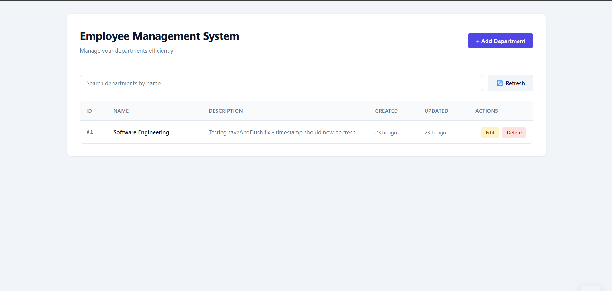

# Employee Management System

A full-stack web application for managing departments and employees, built with **Spring Boot**, **MySQL**, and **vanilla JavaScript**. Features complete CRUD operations, JPA Auditing, custom exception handling, and a responsive UI.

---

## 🚀 Live Demo

*(Local development — clone and run instructions below)*

---

## ✨ Features

- **Full CRUD** for departments (Create, Read, Update, Delete)
- **JPA Auditing** — automatic `createdAt` and `updatedAt` timestamps
- **Custom exception handling** — clean JSON responses for 400/404/409/500 errors
- **Bean Validation** — server-side validation with descriptive messages
- **Search & pagination** endpoints
- **Responsive UI** — modern design with HTML5, CSS3, and vanilla JavaScript (ES6+)
- **XSS-safe frontend** — user content escaped before rendering
- **Externalized secrets** — DB password via environment variable (no hardcoded credentials)

---

## 🛠️ Tech Stack

| Layer | Technologies |
|-------|-------------|
| **Backend** | Java 17, Spring Boot 4.0.8, Spring Data JPA, Hibernate, Spring Security |
| **Database** | MySQL 8.0 |
| **Frontend** | HTML5, CSS3, JavaScript (ES6+), Fetch API |
| **Build** | Maven |
| **Tools** | Lombok, Spring DevTools, Spring Tool Suite 4, Postman |

---

## 📋 API Endpoints

| Method | Endpoint | Description | Status |
|:------:|----------|-------------|:------:|
| `POST` | `/api/departments` | Create a new department | 201 |
| `GET` | `/api/departments` | Get all departments | 200 |
| `GET` | `/api/departments/{id}` | Get department by ID | 200 / 404 |
| `GET` | `/api/departments/paginated` | Get paginated list | 200 |
| `GET` | `/api/departments/search?keyword=` | Search by name | 200 |
| `PUT` | `/api/departments/{id}` | Update department | 200 / 404 |
| `DELETE` | `/api/departments/{id}` | Delete department | 204 / 404 |

### Example Request

```bash
curl -X POST http://localhost:8080/api/departments \
  -H "Content-Type: application/json" \
  -d '{"name":"Engineering","description":"Software Engineering Department"}'
```
  
## 📸 Screenshots

### Main Dashboard



*The main interface showing the department list with search, edit, and delete actions.*